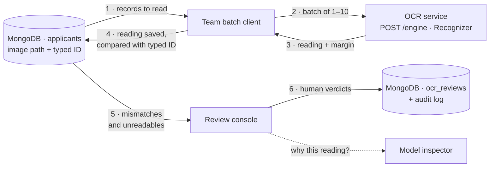
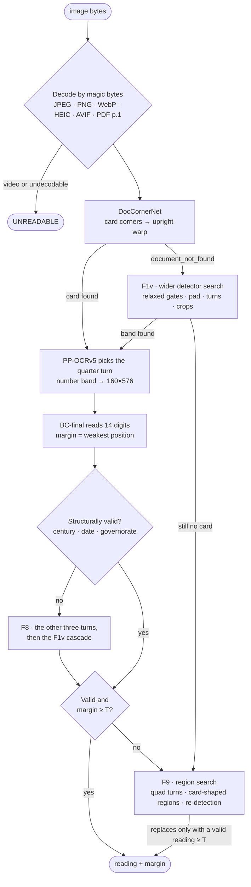
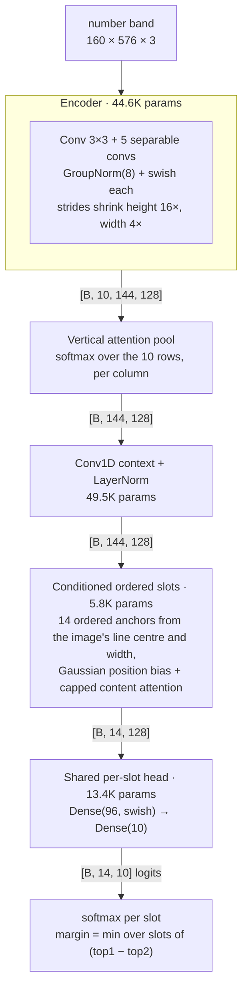
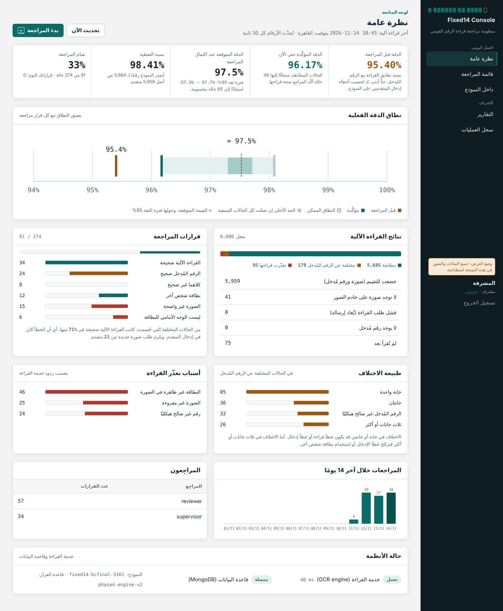

# Fixed14: Egyptian National-ID Verification

**A production OCR system that checks the national ID an applicant typed against the photo of their card, with the statistical evidence to show it can be trusted.**


Applicants upload a photo of the front of their card and type their 14-digit
national ID. Fixed14 finds the card, reads the number with a purpose-built
113K-parameter model, and decides whether the two agree. Cards it cannot settle
go to a human review console. The system has to work on whatever phones
produce: HEIC files saved as `.jpg`, rotated photos, both card sides in one
picture, and scans on a white page.

Developed by the DEPI OCR team. Project owner:
[@asmaasamyhagag22-design](https://github.com/asmaasamyhagag22-design).

---

## Results

These come from a **locked audit**: 377 held-out cards, with pass criteria
committed to the repository before the set was opened, read once
([report](reports/phase4_audit.md)). Intervals are 95% Clopper-Pearson.

| Measure | Result | Declared limit |
|---|---|---|
| Exact 14-digit reading, admitted cards | **342 / 357 = 95.8%** [93.2, 97.6] | – |
| Exact 14-digit reading, all audit cards | **342 / 377 = 90.7%** [87.3, 93.5] | – |
| Against the previous production model, same cards | **+12 cards, 0 worse** (exact sign test p = 0.0005) | non-inferiority, z > 1.645: **z = 4.90** |
| Honest users wrongly not accepted | **4.2%** [2.4, 6.8] | ≤ 10% |
| Typing mistakes silently accepted | **0 of 211** | ≤ 1 |

**Context:**
- The audit pinned the release rule, so these numbers predate the F9 recovery
  stage. A diagnostic re-read with the final pipeline gave 367/377, but the
  official result stays 342/377 because the audit can be spent only once
  ([phase4_final](reports/phase4_final.md)).
- Latency is about **0.7 s median per image on CPU**, with one worker and the
  full recovery cascade. The p95 is about 4.5 s, set by the hard cards that
  need F9.
- The model's weights are **538 KB**.

---

## The system

Two ways in, one recognizer. The batch path serves the agency's MongoDB
pipeline. The `/v1` path verifies one upload and returns a decision. Both run
the same `Recognizer`, whose only input is `recognize(image: bytes)`.



The single-upload path, `POST /v1/national-id/verify`, runs the same
Recognizer and adds the decider below.

**The decider** (`/v1` only). The threshold T = 0.966875 was frozen before
the audit.

| Reading | Decision | What the backend does |
|---|---|---|
| No reading | `UNREADABLE`, with a reason code | leaves it to a validator |
| Equals the typed ID | `MATCH` | marks the ID valid |
| Differs, and margin ≥ T | `MISMATCH_CONFIDENT` | flags it for a validator, and never marks it invalid automatically |
| Differs, and margin < T | `NEEDS_REVIEW` | leaves it to a validator |

The reading is never "corrected" toward the typed ID.

### The recognition cascade



**Each recovery stage runs only on its own trigger:**
- **F1v** runs when no card was found. A structurally impossible reading
  from it is refused, so the card stays not found.
- **F8** runs when a found card gives an impossible reading. A correct reading
  is never impossible, so F8 can never overwrite one.
- **F9** runs when there is no reading, an invalid reading, or a margin below
  T. It picks validity first, then margin.

A valid reading at or above T goes straight out. All three stages run the
unchanged frozen code on a different input: a padded, turned or cropped image,
or a fixed quad.

**What protects the design:**
- **The typed ID never reaches the model.** `recognize(image: bytes)` has no
  parameter for it, and a test checks the source tree for this.
- **The models are frozen.** 16 sealed files are hash-checked at load time.
  `/ready` stays 503 until a golden self-test reproduces the expected outputs.

The stage-by-stage reference is [docs/ARCHITECTURE.md](docs/ARCHITECTURE.md).

### The model: BC-final

A fixed-length reader, not a general OCR. The Egyptian national ID is always
14 digits (century, birth date, governorate, sequence, check digit), and the
architecture builds that in. It has 113,439 parameters, and the weights take
538 KB.



**Why it is built this way:**
- **Fourteen ordered slots instead of CTC.**
  - The output has 14 positions, always in order, so a reading can never be
    13 or 15 digits long.
  - Each position has its own probability distribution.
  - The cost: the model has to learn where the line is. The attention layers
    do that.
- **Vertical attention pool.** Each of the 144 columns chooses which rows to
  trust. This absorbs residual vertical misalignment from detection and
  warping.
- **Conditioned ordered slots.** The 14 anchors are placed from the line's
  centre and width in this particular image, and their order is strict. Digit
  3 can never be read from a position to the left of digit 2.
- **Shared head.** One classifier serves all 14 slots, so the shape of each
  digit is learned once rather than 14 times.
- **Weakest-position margin.**
  - The confidence is set by the least certain digit, not by an average.
  - One doubtful digit is enough to keep a mismatch out of
    `MISMATCH_CONFIDENT`.

---

## Review console

Mismatches and unreadable cards go to a human. In the first production run,
about 1,400 records differed from the typed ID. The console is an Arabic,
right-to-left web application for the reviewers who settle those cases and the
supervisors who track accuracy.

<picture>
  <source media="(prefers-color-scheme: dark)" srcset="docs/images/overview-dark.png">
  
</picture>

<sub>Demonstration mode: 6,000 synthetic applicants. No real record appears.</sub>

**Features:**
- **Accuracy that tightens as reviews come in.** The overview reports:
  - a lower bound and the confirmed figure;
  - an upper bound;
  - a projection with a Wilson 95% interval.
- **Safe concurrent review.** Two reviewers can never decide the same case:
  each case is claimed by an atomic conditional upsert on a unique index. A
  stress test ran 20 simultaneous claims on each of 30 cases and got one winner
  every time.
- **A model inspector.** It shows the band the model saw, its 14 slot-attention
  maps and the probability of every digit. It refuses to serve unless its
  inspection graph reproduces production logits within 1e-4.
- **Security:**
  - scrypt passwords, and server-side sessions stored as SHA-256 digests;
  - CSRF on every write, CSP, and login throttling;
  - three roles;
  - an audit log that holds no national ID.
- **It writes only to its own collections.** The applicants collection is
  read-only to it.
- **Checked:**
  - WCAG 2.1 AA: 0 axe-core violations across 10 pages in 2 themes.
  - Every page renders in under 150 ms with 47,000 applicants.

See [docs/CONSOLE_GUIDE.md](docs/CONSOLE_GUIDE.md) (Arabic).

---

## Engineering practice

This is the part of the project that took the most discipline.

- **Pre-registration.** Each phase commits a rule file to `configs/` before
  computing any number that bears on a decision. Amendments are append-only and
  state whether they came before or after a result.
- **Spent data stays spent.**
  - The locked audit, the internal validation set and the external test set are
    each used once, then marked consumed.
  - A runtime guard (`src/governance/guard.py`) refuses to open a blocked card
    in any process. It reads a blocklist derived from the split manifests and
    pinned to their hashes, and fails closed if they change.
- **Card-level statistics.** Decisions are made per card, never per digit:
  - paired exact sign tests between models;
  - cluster bootstrap by identity group where cards share a person.
- **Privacy by construction.**
  - Log lines are allowlisted, and any run of 14 or more digits is redacted.
  - A scan proves the shipped image holds no card data.
  - Tests check that no real value appears in the source.
- **Reproducible delivery.**
  - Model files are pinned in `docker/model_files.sha256`.
  - Only the import closure of the entry points ships, listed in
    `docker/app_code_files.txt`.
  - Image tags map to a `pipeline_version`, so a rollback needs no client
    change.
- **A decision log.** Over a hundred recorded decisions with reasons, in
  [docs/release/decision_log.md](docs/release/decision_log.md), including the
  ones that reversed earlier work.

---

## Quick start

The service needs Docker, and Linux or WSL:

```bash
bash scripts/phase4_service_docker.sh build
```

The whole stack (engine, model inspector and review console) starts with:

```bash
docker compose --profile engine up -d
```

To try the console with synthetic data and no database:

```bash
python -m console demo        # http://127.0.0.1:8090, user "supervisor", password "demo-password"
```

**More detail:**
- Configuration, API keys and a first call:
  [README_SERVICE.md § Quick start](README_SERVICE.md#quick-start-for-the-team).
- A full handover from a fresh machine to a complete batch:
  [docs/DEPLOYMENT_GUIDE.md](docs/DEPLOYMENT_GUIDE.md).

**Tests:**
- `bash scripts/test_service.sh` is the fast target.
- The full suite has about 1,300 tests.
- Checks that need the private data tree or the upstream detector history
  explain themselves in a fresh clone. For the details, see
  [README_SERVICE.md § For developers](README_SERVICE.md#11-for-developers-tests-lint-and-what-ships).

---

## Repository map

```
src/service/       FastAPI app, recognizer cascade, decider, batch engine, golden self-test
src/extraction/    decoding, BC-final adapter, F1v / F8 recovery (sealed modules marked)
src/geometry/      DocCornerNet card detector (sealed)
src/governance/    runtime data-governance guard
console/           review console: FastAPI + Jinja, MongoDB store, statistics, xlsx export
inspector/         model inspector service (attention maps, per-digit probabilities)
scripts/           phase scripts, Docker build, team API client, blocklist builder
configs/           phase rule files, committed before any number
reports/           one report per phase: the project's history and evidence
docs/              architecture, code walkthrough, deployment, console guide, decision log
models/            pinned model files and their licences
tests/             unit, parity, governance, privacy and end-to-end tests
```

## Documentation

| Document | Contents |
|---|---|
| [docs/ARCHITECTURE.md](docs/ARCHITECTURE.md) | The request path, every stage and why it exists, configuration, rollback |
| [docs/CODE_WALKTHROUGH.md](docs/CODE_WALKTHROUGH.md) | Every shipped file, in reading order |
| [docs/release/ocr_api_contract_v1.md](docs/release/ocr_api_contract_v1.md) | The v1 API contract and the batch engine format |
| [docs/TEAM_API_CLIENT.md](docs/TEAM_API_CLIENT.md) | The batch client that reads MongoDB and calls the engine |
| [reports/phase4_audit.md](reports/phase4_audit.md) | The locked audit: criteria, results, limits |
| [reports/phase4_engine.md](reports/phase4_engine.md) | Batch engine verification and delivery |
| [models/README.md](models/README.md) | Model files, sources and licences |

## Known limitations

- **The audit is consumed.** Later changes, F9 included, cannot be measured on
  clean held-out data.
- **The retake flow is untested.** The project holds no repeat-capture data.
- **The front of the card only.** The back is accepted and ignored.
- **One dependency pin is pending an owner decision.** The OCR image pins
  `pillow==10.4.0`. Raising it requires re-establishing golden parity.

## Licences

- DocCornerNet is MIT-licensed.
- The PaddleOCR models are Apache-2.0.
- Card images, labels, per-card outputs and secrets are not in this
  repository.
